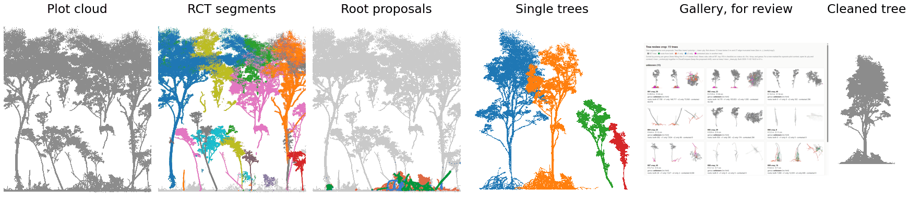
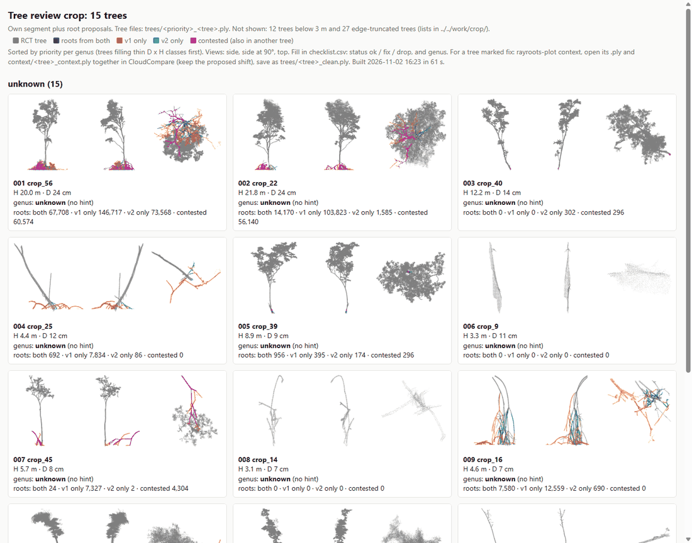
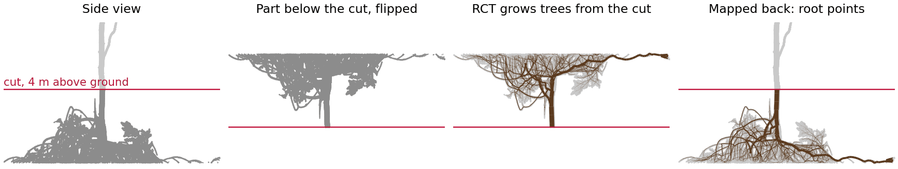
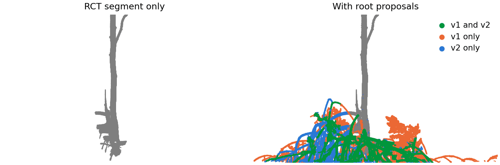
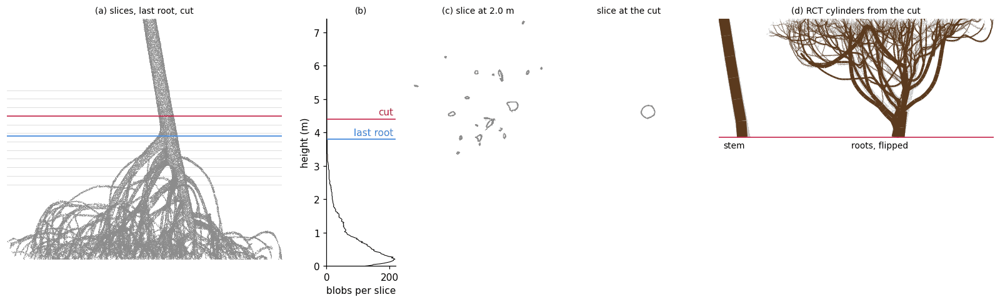
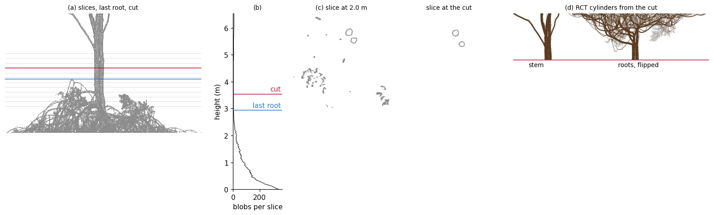

# rayroots

rayroots takes a terrestrial laser scan of a mangrove plot to finished single trees with volumes. RayCloudTools (RCT) segments the plot into trees but misses most prop roots; rayroots proposes those roots per tree. You clean the proposals by hand in a gallery-led review. Rayroots also builds QSM's of single trees and splits each cleaned Rhizophora tree at an automatic cut line and models stem and roots to a volume. The single-tree method builds on modelling prop roots as inverted trees ([Asmath et al., 2025](https://link.springer.com/article/10.1007/s13157-025-01985-x)), but finds the cut line automatically instead of by hand, and models stem and roots with RayCloudTools.



```
A. Plot                                   Cleaning                 B. Single tree
plot cloud -> RCT segments -> root        gallery, checklist,      cut line -> stem / roots ->
proposals -> trees to review         ->   CloudCompare        ->   RCT on both -> volume
```

## Install
1. Install [RayCloudTools](https://github.com/csiro-robotics/raycloudtools) with LAS and Qhull support (WSL or Linux):
   ```
   git clone https://github.com/csiro-robotics/raycloudtools.git
   cd raycloudtools && mkdir build && cd build
   cmake .. -DWITH_LAS=ON -DWITH_QHULL=ON && make -j4 && sudo make install
   ```
2. Create the conda env from this folder: `conda env create -f environment.yml`
3. Activate it: `conda activate rayroots`

## What you need
| input | needed for | notes |
|---|---|---|
| plot LAS, **or** your own `rayextract trees` output (`_segmented.ply`, plus the terrain mesh if you have it) | A | RIEGL scans at 1 cm were tested; other scanners were not |
| boundary csv, `x,y`: scan positions or a polygon | A, optional | in the segmented frame; see [Inputs](docs/METHOD.md#inputs). Without it the whole cloud is used |
| [RayCloudTools](https://github.com/csiro-robotics/raycloudtools) | A, B | settings explained in the [QFL rayextract manual](https://github.com/qforestlab/rayextract-manual) |
| cleaned tree `.ply` + genus | B | `finish` puts them in place |

**Memory:** `rayextract trees` peaked at 7.4 GB on a 20 x 20 m crop (22 M points), which only just fits an 8 GB WSL. Run one RCT
job at a time. For whole plots use a server (`scripts/server_template.sh`) or give WSL more memory in `%UserProfile%\.wslconfig`.
The root step ran on 8 GB, and part B needs about 1 GB per tree.

## Step by step
`P` is your project folder. A step whose output exists is skipped, and `--redo` runs it again. A path given once is remembered,
so later steps need only `--plot` and `--project`. To run A1 to A4 in one go, detached:
```
setsid nohup bash scripts/run_plot.sh <plot>.las --boundary b.csv --project P > run.log 2>&1 &
```

### A1 RCT segmentation
Turns the LAS into a ray cloud, finds the terrain and segments the trees. Skip it if you have your own `rayextract` output.
```
rayroots-plot segment <plot>.las --project P
```
- `las`: the plot LAS file
- `--plot`: name for this plot, used in folder and tree names (optional, default: LAS file name)
- `--project`: project folder, created if missing (optional, default: current folder)
- `--settings`: yaml with the settings you change, see `rayroots/plot/plot.yaml` (optional)
- `--redo`: run this step again even if its output exists (optional)
- `--keep`: keep the LAS copy, ray cloud and RCT tree mesh (optional)
- **Output:** `A_plot/work/<plot>/<plot>_segmented.ply`, `<plot>_mesh.ply`
- **Uses:** `rayimport`, `rayextract terrain`, `rayextract trees`, with flags from `rct` in `rayroots/plot/plot.yaml`

### A2 Root proposals
Attaches root points to their tree below 4 m. See [How it works](#how-it-works).
```
rayroots-plot roots --plot <plot> --project P --boundary b.csv
rayroots-plot roots --plot <plot> --project P --segmented own_segmented.ply --mesh own_mesh.ply   # your own RCT output
```
- `--plot`: name for this plot, used in folder and tree names
- `--project`: project folder, created if missing (optional, default: current folder)
- `--boundary`: csv with x,y of scan positions or polygon corners, in the segmented frame (optional)
- `--segmented`: your own rayextract output instead of A1's (optional)
- `--mesh`: terrain mesh from rayextract terrain, used with `--ground mesh` (optional)
- `--ground`: `grid` (frozen method) or `mesh` (optional, default: grid)
- `--config`: yaml with the method settings you change, see `roots.yaml`; then not the frozen method (optional)
- `--redo`: run this step again even if its output exists (optional)
- `--keep`: keep the cloud with root proposals, split per tree (optional)

Paths given in an earlier step are remembered.

- **Output:** `A_plot/work/<plot>/<stem>_roots.npz`, `<stem>_roots.csv`
- **Uses:** `rayextract trees` on the flipped cloud; `rayroots/plot/roots/` (`flip.py` v1, `v2.py` and `connect.py` v2). Frozen method

### A3 Select trees
Lists the trees of the plot: base inside the boundary + 2 m, with a rough D, H and stem position.
```
rayroots-plot select --plot <plot> --project P
```
- `--plot`: name for this plot, used in folder and tree names
- `--project`: project folder, created if missing (optional, default: current folder)
- `--segmented`: your own rayextract output instead of A1's (optional)
- `--boundary`: csv with x,y of scan positions or polygon corners, in the segmented frame (optional)
- `--settings`: yaml with the settings you change, see `plot.yaml` (optional)
- `--redo`: run this step again even if its output exists (optional)

Paths given in an earlier step are remembered.

- **Output:** `A_plot/work/<plot>/trees_in_plot.csv`
- **Uses:** `rayroots/plot/select.py`

### A4 Review gallery and checklist
Writes one file per tree of 3 m and taller, with previews, ranked so that thin size classes come first.
```
rayroots-plot review --plot <plot> --project P [--plot-genus Rhizophora] [--genus-hints h.csv]
```
- `--plot`: name for this plot, used in folder and tree names
- `--project`: project folder, created if missing (optional, default: current folder)
- `--segmented`: your own rayextract output instead of A1's (optional)
- `--boundary`: csv with x,y of scan positions or polygon corners, in the segmented frame (optional)
- `--settings`: yaml with the settings you change, see `plot.yaml` (optional)
- `--plot-genus`: genus of every tree without a hint, e.g. Rhizophora (optional)
- `--genus-hints`: csv with columns tree or seg_id, and genus (optional)
- `--existing-trees`: csv with genus, H_m, D_cm of trees you already have; their size classes rank lower (optional)
- `--no-roots`: tree files without root proposals (optional)
- `--redo`: run this step again even if its output exists (optional)

Paths given in an earlier step are remembered.

- **Output:** `A_plot/review/<plot>/`: `00_gallery.html`, `checklist.csv`, `trees/`
- **Uses:** `rayroots/plot/review.py`, `page.py`, `store.py`



Open the gallery and set `status` (ok / fix / drop) and `genus` per tree in `checklist.csv`. The colours show where a point
comes from: grey RCT, green both methods, orange v1 only, blue v2 only, magenta contested.

### A5 Context
For a tree that misses parts: a root or a stem piece was given to a neighbour, or left unsegmented. Context cuts the plot cloud in
a radius around the tree. Open both files in CloudCompare and copy the missing points into the tree.
```
rayroots-plot context --plot <plot> --project P [tree ...] [--radius 6]
```
- `tree ...`: tree names or segment ids (optional, default: all trees marked `fix` in `checklist.csv`)
- `--plot`: name for this plot, used in folder and tree names
- `--project`: project folder, created if missing (optional, default: current folder)
- `--radius`: radius in m around the stem (optional, default: 6)
- `--segmented`: your own rayextract output instead of A1's (optional)
- `--settings`: yaml with the settings you change, see `plot.yaml` (optional)

Paths given in an earlier step are remembered.

- **Output:** `A_plot/review/<plot>/context/<tree>_context.ply`
- **Uses:** `rayroots/plot/context.py`

### Manual cleaning
Do this between A5 and A6, for each tree marked `fix`. In CloudCompare, open `trees/<priority>_<tree>.ply` and its context file
together and keep the proposed shift. Remove false points, copy in missing ones, and save as `trees/<tree>_clean.ply`.
Check magenta points: they are also in another tree.

### A6 Finish
Copies the `ok` trees and the `_clean` files to the finished trees. Without `--apply` it only shows what it would do.
```
rayroots-plot finish --plot <plot> --project P --apply
```
- `--plot`: name for this plot, used in folder and tree names
- `--project`: project folder, created if missing (optional, default: current folder)
- `--apply`: copy and register; without it, only show what it would do (optional)
- **Output:** `A_plot/finished_trees/<genus>/<tree>.ply`, `A_plot/tree_register.csv`
- **Uses:** `rayroots/plot/finish.py`

### B1 Cut line and split
Finds the cut and splits the tree into stems and roots. Avicennia is split at forks below 1.3 m instead. Check the QC figure.
Part B runs on any cleaned tree files, no register needed:
```
rayroots-single split --input tree.ply --genus Rhizophora
rayroots-single split --input trees/ --genus Rhizophora [--out DIR]
rayroots-single split --project P [--tree T]          # the trees A6 registered
```
- `--input`: one tree `.ply`, or a folder of them; tree name = file name without `_clean` and `.ply`
- `--genus`: Rhizophora or Avicennia, for all files (optional when the folder is named after the genus)
- `--out`: output folder (optional, default: `<input folder>/rayroots_single/`)
- `--project`: instead of `--input`: project folder with `A_plot/tree_register.csv` (optional, default: current folder)
- `--tree`: this tree only; it is redone (optional)
- `--redo`: all trees again (optional)
- `--settings`: yaml with the settings you change, see `rayroots/single/single.yaml` (optional)
- **Output:** `qc/<tree>.png`; stems and roots files in `work/`, in the `--out` folder or `B_trees/`
- **Uses:** `rayroots/single/split.py` (`slice_profile`, `find_cut`, `split_roots`, `split_dbh`)

To correct a cut, add a row to `B_trees/overrides.csv` (columns `tree`, `h_cut_above_z0`, `n_stems`, `reason`) and run the command
with `--tree T`. `z0` is the 0.1th percentile of the tree's heights, listed in `split_log.csv`; it is not the ground.

### B2 RCT on stem and roots, volume
Models each stem as it stands and the roots flipped about the cut, then writes volume, DBH and height.
```
rayroots-single model --input tree.ply [--out DIR] [--tree T] [--ensemble]
rayroots-single model --project P [--tree T] [--ensemble]
```
- `--input`, `--out`: the same as in B1; the genus comes from B1
- `--project`: instead of `--input`: project folder with `B_trees/` (optional, default: current folder)
- `--tree`: this tree only; it is redone (optional)
- `--redo`: all trees again (optional)
- `--ensemble`: 15 runs instead of the central run only (optional)
- `--keep`: keep the ensemble's tree files (optional)
- `--settings`: yaml with the settings you change, see `single.yaml` (optional)
- **Output:** `tree_volumes.csv`, in the `--out` folder or `B_trees/`; panel (d) in the QC figure
- **Uses:** `rayimport`, `rayextract trees`, with flags from `rct` in `rayroots/single/single.yaml`; `rayroots/single/model.py`

The default is one central run per tree. Trees flagged `rct split`, `stems merged` or `vol gap` are listed at the end with the
command for the 15-run `--ensemble`. `vol_rct` uses RCT's radii; `vol_meas` uses the same skeleton with radii measured from the points.

## Outputs
**Part A**

| file | content |
|---|---|
| `A_plot/review/<plot>/00_gallery.html` | previews to review |
| `A_plot/review/<plot>/checklist.csv` | your decision per tree |
| `A_plot/review/<plot>/trees/`, `context/` | tree files, and their surroundings |
| `A_plot/finished_trees/<genus>/<tree>.ply` | finished trees |
| `A_plot/tree_register.csv` | one row per finished or dropped tree |

**Part B**

| file | content |
|---|---|
| `B_trees/tree_volumes.csv` | volume, DBH, height and flags, one row per tree and per stem |
| `B_trees/qc/<tree>.png` | where the tree was cut |

Volumes in `tree_volumes.csv`, one column per part and method (m³):
- `vol_stems_rct`, `vol_roots_rct`, `vol_base_rct`: RCT's cylinders, RCT's radii
- `vol_stems_meas`, `vol_roots_meas`, `vol_base_meas`: the same skeleton, radii measured from the points
- `vol_roots_area`: roots only, cross-section area measured from the points per segment (ellipse for oval and fused roots; central run).
  Experimental, not validated.
- `vol_rct` = stems + base + roots, RCT
- `vol_meas` = stems + base + roots, measured radii
- `vol_area` = stems and base RCT + `vol_roots_area`

`vol_base_*` only for Avicennia. Per-segment radii and areas (`r_rct_m`, `r_meas_m`, `area_m2`, `area_level`, `axis_ratio`) are in
`work/rct/<tree>/<tree>_<part>_segments.csv`.

Everything else is in `work/` per part, or deleted unless `--keep`. `rayroots-plot overview --project P` shows progress across
plots in `A_plot/overview.html`. All files: [docs/METHOD.md](docs/METHOD.md).

## How it works
### Plot level
RCT grows trees up from the ground, so prop roots, which go down and out, end up unsegmented or in a neighbour. Below 4 m rayroots
looks for them in two independent ways.

- **v1** flips the cloud upside down, so roots look like branches growing up from the stem. It runs `rayextract trees` on that
  and keeps the points close to the cylinders.
- **v2** cuts the points into small fragments and grows from the stem with simple rules: thickness, direction, turning angle
  and branching.



**Why both:** they make different mistakes. v1 finds more root points (higher recall), v2 adds fewer wrong ones (higher precision).
Points found by both are the most reliable, and points found by one are worth checking. The colours show which.

| colour | found by | share that is hand-cleaned wood, SU6_psp2 | SU14_psp3 | meaning |
|---|---|---:|---:|---|
| green | both | 0.92 | 0.98 | mostly keep |
| blue | v2 only | 0.77 | 0.76 | mostly keep |
| orange | v1 only | 0.35 | 0.81 | check |
| grey | RCT | 0.33 | 0.61 | |

SU6_psp2 is pooled over 6 trees, without SU6_psp2_2 (zero by construction); SU14_psp3 is 1 tree, so its orange value carries little weight.



**CURRENT STATUS:** these are proposals that speed up manual cleaning, root detection is not (yet?) perfect. Tests on Suriname plots; root detection method v1 reaches
precision 0.53 and recall 0.69, v2 precision 0.65 and recall 0.53 ([validation](docs/validation/roots.md)). The 4 m cut is fixed for
every plot, a contested point can be given to two trees, and the method was tested on 2 unseen plots - with a limited amount of hand segmented trees - only.

### Single tree QSM building
Once manual cleaning of all (or a number of) trees has finished, QSM's can be built for every seperate tree. Here, for every tree flagged as a *Rhizophora*, the tree is cut into horizontal slices and count the "blobs" in each. Below the highest prop root a slice has many blobs, above it one per
stem (in most cases). The last root is the bottom of the lowest clean run, and the cut is the last root + 0.6 m. The roots below the cut are flipped
about it (z' = 2 z_cut - z), so RCT grows stem and roots like trees, which gives the volume. 



A tree with two stems works the same way, with two blobs above the last root.



The cut is within 0.5 m of the hand cut on 22 of 27 trees, with a mean absolute difference of 0.38 m ([validation](docs/validation/cut.md)).

## Known limits and not tested
- **Part B is not validated yet.** It reproduces the study's logged results, but the choice between `vol_rct` and `vol_meas` is open.
- **B needs cleaned trees.** The two stems of `SU7_psp3_364_136` were cut at 1.74 m and 3.91 m uncleaned, against 3.53 m cleaned.
- **Cut errors:** `SU15_psp1_6` is 1.34 m too low and **not flagged**, taken as multi-stem. `SU14_psp3_4` is 1.71 m too high, flagged `short run`.
- **The central run** can be well off where RCT splits a tree; that is why flagged trees get the rerun command.
- **Avicennia base:** it counts in the tree total and has its own column; how to divide it over the stems is open.
- **Other genera** are skipped by part B, with a message.
- **Not tested:** Avicennia with forks; root proposals on Avicennia; other sites, scanners or scan settings.

More in [docs/METHOD.md](docs/METHOD.md#known-limits).

## Origin
Developed by Jasper Feyen (Q-ForestLab, Ghent University) in a TLS study of mangroves in Suriname.

## references

Devereux, T., Lowe, T., Rivory, J., Reckziegel, R. B., Calders, K., Aryal, R. R., Eaton, G., Cooper, Z., Levick, S., Phinn, S., & Woodgate, W. (2026). RayExtract: A fast, scalable method for tree volume reconstruction from terrestrial laser scanning. Remote Sensing of Environment, 334, 115162. https://doi.org/10.1016/j.rse.2025.115162


